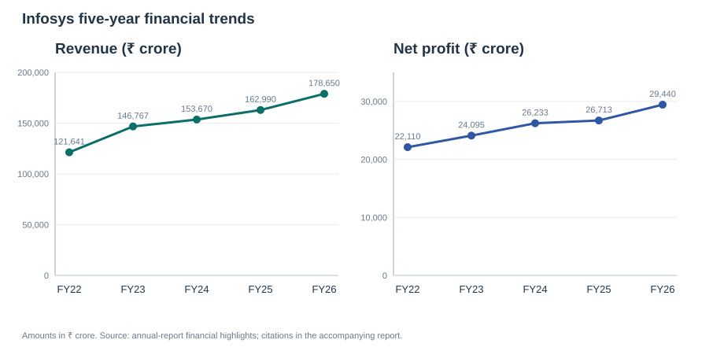

# Infosys Annual Report Intelligence: FY2022–FY2026

## Executive overview

Across the five reports, consolidated revenue increased from ₹121,641 crore in FY2022 to ₹178,650 crore in FY2026 (+46.9%). Net profit attributable to owners increased from ₹22,110 crore to ₹29,440 crore (+33.2%). Free cash flow varied year to year and was highest in this series in FY2025 at ₹34,549 crore. FY2026 reports an adjusted operating margin; its footnote says the measure excludes the effect of provisions related to India's Labour Codes, so it is not strictly like-for-like with earlier margin figures. [FY2022.pdf, PDF p. 21] [FY2025.pdf, PDF p. 16] [FY2026.pdf, PDF p. 17]

## Verified financial comparison

All amounts are consolidated, in ₹ crore, as presented in the corresponding report highlights. FY2026 operating margin is explicitly adjusted.

| Financial year | Revenue (₹ crore) | Net profit (₹ crore) | Operating margin | Free cash flow (₹ crore) | Source |
|---|---:|---:|---:|---:|---|
| FY2022 | 121,641 | 22,110 | 23.0% | 22,803 | FY2022.pdf, PDF p. 21 |
| FY2023 | 146,767 | 24,095 | 21.0% | 20,443 | FY2023.pdf, PDF p. 16 |
| FY2024 | 153,670 | 26,233 | 20.7% | 23,865 | FY2024.pdf, PDF p. 16 |
| FY2025 | 162,990 | 26,713 | 21.1% | 34,549 | FY2025.pdf, PDF p. 16 |
| FY2026 | 178,650 | 29,440 | 21.0% (adjusted) | 33,097 | FY2026.pdf, PDF p. 17 |

### Year-on-year growth

Growth is calculated from the reported ₹ crore values in the table above: $(current year / prior year - 1) \times 100$. Percentages are rounded to two decimal places.

| Financial year | Revenue growth | Net profit growth | Source values |
|---|---:|---:|---|
| FY2023 | 20.66% | 8.98% | [FY2022.pdf, PDF p. 21] [FY2023.pdf, PDF p. 16] |
| FY2024 | 4.70% | 8.87% | [FY2023.pdf, PDF p. 16] [FY2024.pdf, PDF p. 16] |
| FY2025 | 6.06% | 1.83% | [FY2024.pdf, PDF p. 16] [FY2025.pdf, PDF p. 16] |
| FY2026 | 9.61% | 10.21% | [FY2025.pdf, PDF p. 16] [FY2026.pdf, PDF p. 17] |

## Financial findings

**Revenue and growth quality.** Revenue increased every year. Reported growth was especially strong in FY2023, slowed in FY2024–FY2025, and accelerated again in FY2026. A larger revenue base can support scale and broaden opportunities, but top-line growth alone does not show whether new work is equally profitable or recurring. [FY2022.pdf, PDF p. 21] [FY2023.pdf, PDF p. 16] [FY2024.pdf, PDF p. 16] [FY2025.pdf, PDF p. 16] [FY2026.pdf, PDF p. 17]

**Profitability.** Net profit rose in every year, but cumulative growth from FY2022 to FY2026 (+33.2%) was below revenue growth (+46.9%). Year-on-year profit growth was much slower than revenue growth in FY2023 and FY2025, while it outpaced revenue growth in FY2024 and FY2026. This suggests that sales expansion did not translate proportionally into owner-attributable net profit across the full period; the figures alone do not establish why. [FY2022.pdf, PDF p. 21] [FY2023.pdf, PDF p. 16] [FY2024.pdf, PDF p. 16] [FY2025.pdf, PDF p. 16] [FY2026.pdf, PDF p. 17]

**Operating margin.** The reported margin declined from 23.0% in FY2022 to 20.7% in FY2024, then recovered to 21.1% in FY2025. FY2026 reports 21.0% as an *adjusted* margin. The series indicates a lower margin level than FY2022, with some subsequent stabilization; the adjusted FY2026 measure limits a strict year-to-year comparison. Margin movement matters because it indicates how much operating profit is retained from revenue, but these highlights do not explain the causes. [FY2022.pdf, PDF p. 21] [FY2024.pdf, PDF p. 16] [FY2025.pdf, PDF p. 16] [FY2026.pdf, PDF p. 17]

**Cash generation.** Free cash flow fell from ₹22,803 crore in FY2022 to ₹20,443 crore in FY2023, rose to ₹23,865 crore in FY2024 and a five-year high of ₹34,549 crore in FY2025, then eased to ₹33,097 crore in FY2026 (about 4.2% lower year on year). The FY2025–FY2026 level remained above FY2022–FY2024, but the variation is relevant to planning investment, acquisitions, and shareholder distributions. This is a business implication, not a claim that any particular use of cash caused the movement. [FY2022.pdf, PDF p. 21] [FY2023.pdf, PDF p. 16] [FY2024.pdf, PDF p. 16] [FY2025.pdf, PDF p. 16] [FY2026.pdf, PDF p. 17]

## Business risks

### Risks disclosed by Infosys

The reports identify external and operating risks including the pandemic and geopolitical or macroeconomic events, supply-chain pressure, talent availability, technology disruption, cybersecurity, and—in later reports—evolving regulation and advances in AI. The exact list changes by year: FY2023 names inflation and technology disruption, FY2024 names cybersecurity, FY2025 names evolving regulations and cybersecurity, and FY2026 includes AI advances and cybersecurity. These are the company’s disclosed risk themes, not predictions that each risk will materialize. [FY2022.pdf, PDF p. 138] [FY2023.pdf, PDF p. 130] [FY2024.pdf, PDF p. 121] [FY2025.pdf, PDF p. 122] [FY2026.pdf, PDF p. 131]

### Possible business implications — interpretation

- Geopolitical, economic, and supply-chain disruption could make client demand, delivery conditions, and planning less predictable.
- Talent constraints could limit the capacity to staff projects or develop newer capabilities; retaining and reskilling people may therefore matter to execution.
- Technology change, cybersecurity incidents, and regulatory requirements could increase the need for investment in secure, compliant services. They may also create demand for related client services, but the risk disclosures do not prove that Infosys will capture that opportunity.

These are analytical interpretations of the disclosed exposures, not statements attributed to Infosys or forecasts. [FY2022.pdf, PDF p. 138] [FY2023.pdf, PDF p. 130] [FY2024.pdf, PDF p. 121] [FY2025.pdf, PDF p. 122] [FY2026.pdf, PDF p. 131]

## Strategic developments

- **FY2022 — cloud and digital foundations:** The report discusses cloud modernization and the expanding adoption of digital technologies to improve resilience, agility, and customer experience. [FY2022.pdf, PDF p. 3] [FY2022.pdf, PDF p. 16]
- **FY2023 — AI-first direction:** Infosys describes AI and cloud as transformation enablers and presents its AI-first approach, including Topaz. [FY2023.pdf, PDF p. 3] [FY2023.pdf, PDF p. 17]
- **FY2024 — generative AI and governance:** Generative AI becomes a prominent theme. The report also identifies data readiness, regulatory compliance, model security, bias, and privacy as issues to address. [FY2024.pdf, PDF p. 3]
- **FY2025 — scaling enterprise AI:** The report describes moving beyond pilots toward scaling adoption, while building data strategy, infrastructure, and organizational capacity. [FY2025.pdf, PDF p. 3]
- **FY2026 — enterprise value at scale:** The report frames AI around measurable enterprise outcomes and describes its AI First Value Framework and industry playbooks as ways to scale use cases. [FY2026.pdf, PDF p. 3] [FY2026.pdf, PDF p. 24]

**Positioning implication — interpretation.** This progression suggests a shift in Infosys’s stated positioning: from cloud and digital transformation foundations toward AI-enabled services and approaches for enterprise-wide adoption. If clients adopt these services, the progression could help Infosys compete for transformation work; it also raises execution demands around talent, data, governance, security, and demonstrable customer value. The reports describe strategy and offerings; this progression alone does **not** prove commercial success, customer adoption, or resulting profit growth.

## How the AI system works

1. **PDF text extraction:** The existing extraction script uses pypdf to read each PDF page and writes a `--- Page N ---` heading before its text. This analysis reuses the existing files in `data/processed/`; PDF extraction was not rerun.
2. **Page-aware chunks and vector index:** The RAG script splits each page into chunks of up to 2,200 characters with 220 characters of overlap, without crossing page boundaries. ChromaDB stores the text with financial year, source filename, PDF page number, and chunk number as metadata.
3. **Ollama retrieval:** Questions and report chunks are embedded by the local `nomic-embed-text:latest` model through Ollama’s HTTP API. ChromaDB retrieves matching passages and returns their source metadata for citations.
4. **crewAI analysis and reporting:** A sequential crew runs a Financial Analyst task, a Risk & Strategy Analyst task, and a final synthesis task using `qwen2.5:latest` through crewAI. Python parses the report-highlight figures and generates the Markdown report and SVG chart. For this revision, a separate Python check calculated the year-on-year growth percentages from those verified figures. The narrative was source-reviewed; model output and citation formatting alone are not treated as proof that a statement is correct.

## Limitations and human verification

- Three extracted pages contain no text: FY2022 PDF page 362, FY2023 page 358, and FY2026 page 2. No OCR was run, so image-only content on those pages is unavailable to search.
- PDF extraction can disrupt table layout, spacing, or symbols (including currency symbols). A retrieved passage may also be incomplete or less relevant than it appears.
- FY2026 reports an adjusted operating margin; comparisons with earlier margins should be treated cautiously. This analysis does not independently normalize accounting measures.
- Check financial values, interpretations, and citations against the cited PDF pages before submission or decision-making. Risk implications in this report are explicitly labeled as interpretation, not as company forecasts.
